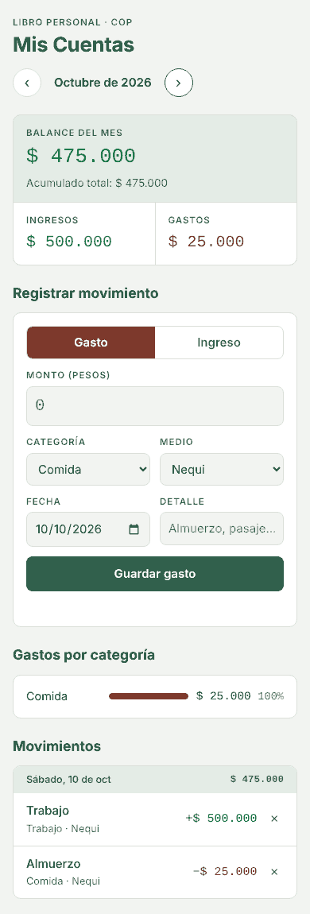

# Mis Cuentas

Libro de cuentas personal en pesos colombianos (COP). Registra tus gastos e ingresos desde el celular o el computador, mira el balance del mes y en qué se te va la plata. Gratis, sin registro y **privado**: tus datos nunca salen de tu dispositivo.

**Úsala aquí:** https://tamalete.github.io/mis-cuentas/



## Qué hace

- Registra gastos e ingresos con categoría, medio de pago, fecha y detalle.
- Resumen del mes: ingresos, gastos, balance y acumulado total; navega entre meses.
- Gastos por categoría con barras y porcentaje.
- Movimientos agrupados por día, con el neto de cada día.
- Medios de pago editables (Nequi, Bancolombia, Daviplata, Efectivo… o los tuyos).
- Respaldo: exporta a JSON o CSV (abre en Excel o Google Sheets) e importa desde JSON.
- Se instala como app y funciona sin internet.

## Privacidad

No hay servidor ni base de datos. Todo se guarda en el almacenamiento local (`localStorage`) de tu navegador. Nadie más puede ver tus cuentas, ni siquiera quien publicó la página.

La contracara: si borras los datos del navegador, usas modo incógnito o cambias de dispositivo, no verás tus movimientos. Por eso existe el **respaldo**: exporta el JSON de vez en cuando y, en el otro dispositivo, usa **Importar JSON**. Importar no duplica movimientos que ya tengas.

## Instalarla en el celular

- **Android (Chrome):** abre el link, toca el menú ⋮ y elige **Instalar app** o **Agregar a pantalla de inicio**.
- **iPhone (Safari):** abre el link, toca **Compartir** y luego **Agregar a pantalla de inicio**.

Queda con su ícono, como cualquier app, y abre aunque no tengas datos.

## Tecnología

HTML, CSS y JavaScript puro, sin frameworks ni proceso de build. Publicada con GitHub Pages.

```
index.html            estructura
styles.css            estilos (modo claro y oscuro automático)
app.js                lógica y almacenamiento local
sw.js                 service worker (uso sin internet)
manifest.webmanifest  datos para instalarla como app
icons/                íconos
```

Para probarla en tu computador: `python3 -m http.server` dentro de la carpeta y abre `http://localhost:8000`.

## Licencia

MIT. Úsala, cópiala y mejórala.
